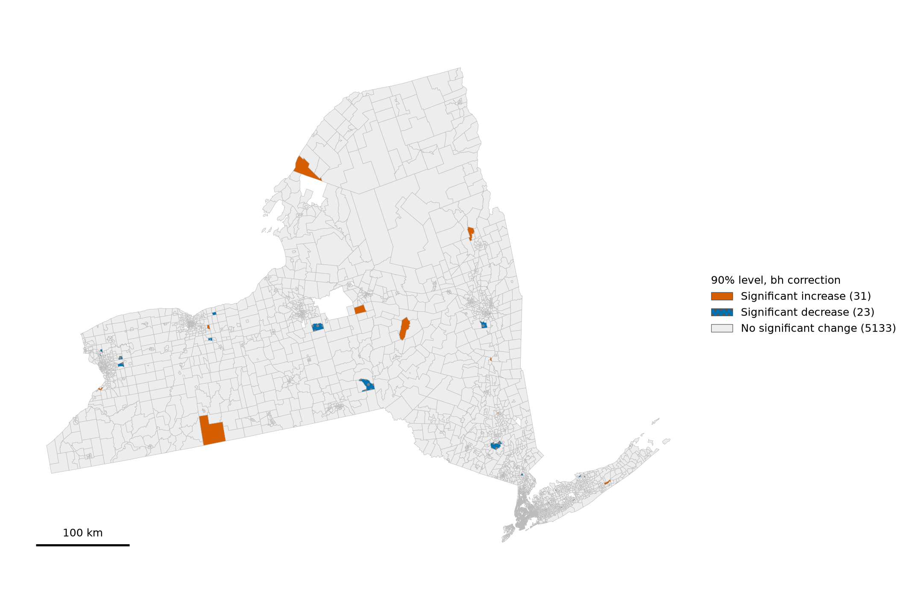
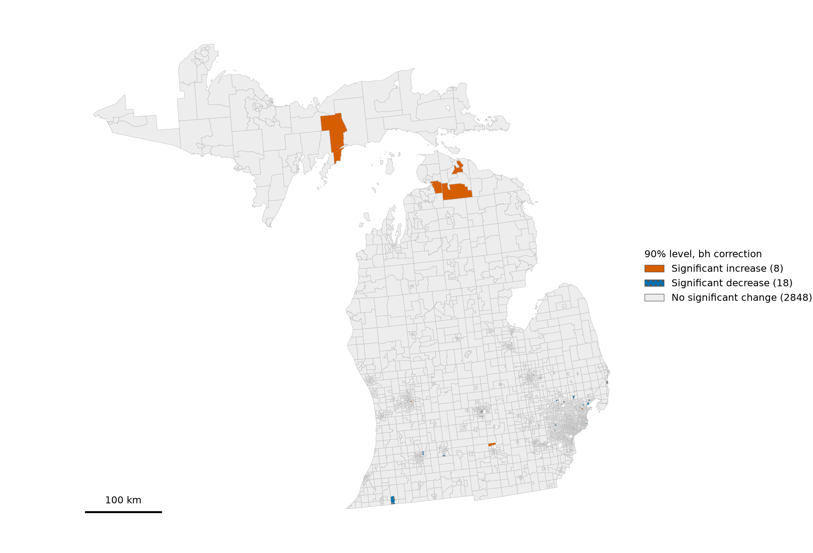

# Real household income change across Michigan and New York census tracts, 2015–2019 to 2020–2024

**Status:** confirmatory run complete; awaiting independent review (section 9)
**Study plan:** [PLAN_ROUND_19.md](../../PLAN_ROUND_19.md)
**Manifest:** [`examples/manifests/r19_mi_ny_tract_income_change.json`](../../examples/manifests/r19_mi_ny_tract_income_change.json), SHA-256 `8f205f51a3de3b29e5f8713fcf7a26fba85ca1bd977adf660e69dd30033fb126`
**Engine:** Census Research Engine, branch `phase19/tract-study` (released as v0.18.0)

## Summary

The study pre-registered three hypotheses about 8,179 census tracts in Michigan and New York, on 2020 tract geography.

- **H1, supported.** Mean household income, in 2024 dollars and adjusted for each tract's regional price level, was **$3,458 higher** in 2020–2024 than in 2015–2019 (90% CI $3,093 to $3,824). This is the mean over tracts.
- **H2, not supported.** The prediction was that real income rose more where more adults hold a bachelor's degree, i.e. that the income–education gradient steepened. The estimated change in slope is **−$66 per percentage point** (90% CI −$123 to −$8). The point estimate runs the opposite way: the gradient was, if anything, slightly flatter in 2020–2024.
- **H3, supported.** New York tracts gained **$3,867 more** than Michigan tracts on average (90% CI $3,232 to $4,503). Mean tract change was about $4,900 in New York and $950 in Michigan.

The run was confirmatory with no deviations. All three findings hold in every real-dollar sensitivity variant (section 6).

The average gain is real and well measured. Individual tracts are a different matter: their changes are mostly within sampling error. Only 1% of tracts show a change distinguishable from zero after correction for multiple testing (section 7).

## 1. Question and hypotheses

Between the 2015–2019 and 2020–2024 ACS periods, did real household income rise across Michigan and New York neighbourhoods? Did it rise more where adults were more educated?

| Id | Hypothesis (as registered) | Model (`fit_replicate`, OLS) | Test |
| :--- | :--- | :--- | :--- |
| H1 | Real mean household income was higher in 2020–2024 than in 2015–2019 (unweighted mean of tract changes) | `mean_hh_income ~ C(Year)`, target `these_areas` | `C(Year)[T.2024]` > 0 |
| H2 | The cross-tract slope of real mean income on the bachelor's share was steeper in 2020–2024 (state intercepts fixed) | `mean_hh_income ~ C(Year) * pct_bachelors + C(state)`, target `conservative` | interaction > 0 |
| H3 | The mean tract change differed between New York and Michigan | `mean_hh_income ~ C(Year) * C(state)`, target `these_areas` | interaction ≠ 0 |

Correction: Holm across all three, at 90% (the ACS convention).

## 2. Preregistration

| Event | Time (UTC) | Commit |
| :--- | :--- | :--- |
| Study plan committed | 2026-11-14 | `a5fa44c` |
| Manifest validated (`create_manifest`, offline metadata only) and committed alone, then pushed to GitHub | 2026-11-14T20:33:49Z | `3f0b1fe` |
| First study data request (`run_manifest`) | after 20:33:49Z | — |

**What the authors had seen before registering:**
- county-level change in mean household income for the same states and releases (+$3,100 per county; `docs/case_study_mi_ny.md` section 8);
- the structure of tract-level ACS sampling-error correlation (Round 16 C1). That work downloaded the 2019 tract `B19001` household-count replicate files, but not income or education values.

No tract-level income change, education gradient or state difference had been computed.

H1 was therefore expected from the county result. H2 and H3 were open.

## 3. Data

| Item | Value |
| :--- | :--- |
| Source | ACS 5-year detailed tables, 2015–2019 (release 2019) and 2020–2024 (release 2024), Census Data API, retrieved 2026-11-14 with the owner's API key |
| Tables | `B19025` aggregate household income, `B19001` households, `B15002` educational attainment (adults 25+) |
| Replicates | Census variance replicate estimate (VRE) files for each table, release and state (12 files; URLs and SHA-256 in `run.json`). All passed the published-MOE self-check |
| Units | 8,368 2020 tracts with 2019 values (apportioned) and 8,414 with 2024 values. After complete-case: 8,179 tracts, 16,240 tract-periods; 8,061 tracts have both periods |
| Prices | R-CPI-U-RS to 2024 dollars (2019 factor 1.2307), then divided by the BEA Regional Price Parity / 100 of the tract's county area: its MSA, else the state's nonmetro part. Each release uses its own year's RPP |

**Measures:**
- `mean_hh_income` = `B19025_001` / `B19001_001` (the Census definition of mean household income);
- `pct_bachelors` = (`B15002_015`–`_018` + `_032`–`_035`) / `B15002_001` × 100.

Means are used, not medians, because `B19013` (median income) has no published replicates, so a change in the median would have no exact sampling SE.

## 4. Methods

**Tract harmonization (new in this round).**
- The 2019 release is on 2010 tracts, so it was apportioned to 2020 tracts using the Census 2010–2020 tract relationship file with block weights: housing-unit weights for `B19025`/`B19001`, population weights for `B15002`.
- Two target tracts were covered below 99% by the input and were dropped; 12 source tracts were not in the crosswalk.
- The Census VRE replicates for 2019 were apportioned **with the same weights**, so every replicate SE is the exact sampling SE of the apportioned estimate.

**Self-check.** The apportioned VRE `estimate` column reproduces the apportioned API estimate **exactly**: difference 0.0 for all 11 variables and over 8,300 tracts each (`run.json` → `replicates.apportioned_estimate_check`).

**Uncertainty.**
- Each model is refitted on the 80 replicates, with every replicated variable replaced by its replicate value, including the derived mean and share.
- The two periods are independent samples: their 5-year periods do not overlap.
- `these_areas` intervals use the replicate SE: the uncertainty is ACS sampling error for these tracts.
- `conservative` (H2) adds the model SE, because H2 is a claim about a relationship.

**Reliability.** A CV screen at 30% on the outcome flagged 108 tract-periods. As pre-registered, they were flagged and not dropped.

**Full methods text:** `methods.md` in the bundle, generated from the manifest and the run.

## 5. Confirmatory results

`analysis_status: confirmatory`, deviations: none. The run's bundle SHA-256 (`bundle.json`) is `95c560e3…6344e`. A second, independent run of the same manifest reproduced `hypotheses.json` byte for byte.

| Hypothesis | Estimate | SE (basis) | 90% CI | p (one-sided where registered) | p, Holm | Result |
| :--- | ---: | ---: | :--- | ---: | ---: | :--- |
| H1: change in mean | +$3,458 | $222 (replicate) | [$3,093, $3,824] | 7.2e-55 | 2.2e-54 | **Supported** |
| H2: change in gradient | −$65.6 per pp | $34.7 (total) | [−$122.7, −$8.4] | 0.970 | 0.970 | **Not supported** |
| H3: NY − MI change | +$3,867 | $386 (replicate) | [$3,232, $4,503] | 1.4e-23 | 2.7e-23 | **Supported** |

**Reading H2.**
- The registered direction was "steeper". The estimate is negative, so the one-sided p-value is 0.97 and H2 is not supported.
- The interval lies below zero, but "flatter" was not registered, so the flatter gradient is an **exploratory observation, not a confirmatory finding**.
- Descriptively, the per-period slopes are $2,113 per percentage point in 2015–2019 (90% CI 2,057–2,169) and $2,032 in 2020–2024 (1,960–2,104), in 2024 dollars.

## 6. Sensitivity (exploratory, pre-specified)

The registered models are refitted on the same analysed data (file hashes checked against `run.json`).

| Variant | H1 | H2 | H3 |
| :--- | ---: | ---: | ---: |
| Registered | +3,458 [3,093, 3,824] | −65.6 [−122.7, −8.4] | +3,867 [3,232, 4,503] |
| Drop CV-flagged tracts | +3,082 [2,714, 3,450] | −74.0 [−130.3, −17.8] | +3,566 [2,967, 4,165] |
| Balanced panel only (8,061 tracts) | +3,486 [3,117, 3,854] | −66.5 [−123.9, −9.1] | +3,942 [3,302, 4,583] |
| Household-weighted (WLS) | +3,236 [2,833, 3,638] | −63.0 [−121.0, −5.0] | +3,053 [2,318, 3,789] |
| State RPP areas (not county-metro) | +3,336 [2,967, 3,706] | −79.6 [−139.6, −19.5] | +3,584 [2,941, 4,228] |
| Nominal dollars (no CPI, no RPP) | +23,641 | +344 [282, 407] | +6,568 |

All real-dollar variants agree in sign and size.

The nominal row shows why price adjustment is not optional here. Without the CPI conversion, 2015–2019 dollars are about 23% smaller, so the whole 2019 relationship, slope included, shrinks by that factor. That mechanically makes the 2020–2024 slope look steeper. The nominal "H2" sign comes from inflation alone.

## 7. Where change happened (exploratory, pre-specified)

**Per-tract change.**
- For the 8,061 tracts present in both periods, the change has an exact SE: the replicate SEs of the two independent periods, combined.
- The **median SE of a tract's change is $12,775**, against a mean change of $3,486.
- 18% of tract changes differ from zero at the uncorrected 90% level, and 55.7% of the point estimates are positive.
- After Benjamini–Hochberg correction within each state, only a few tracts remain:

| State | Tracts | Mean change | Median | Significant increase (BH) | Significant decrease (BH) |
| :--- | ---: | ---: | ---: | ---: | ---: |
| Michigan | 2,874 | +$949 | +$635 | 8 | 18 |
| New York | 5,187 | +$4,891 | +$3,360 | 31 | 23 |




**Spatial pattern.**
- Global Moran's I of the tract change (queen contiguity) is small but positive: 0.054 in Michigan and 0.079 in New York (permutation p 0.001 for both).
- Local Moran's I (two-sided, 9,999 permutations, BH at 0.10) flags no Michigan tract and 21 New York tracts (9 low-low, 6 high-high, 3 low-high, 3 high-low).

Read this with the Round 16 caveats:
- local tests have little power at this noise level;
- spatially varying sampling variances can create spurious local clusters;
- the change is dominated by sampling noise (median CV of a tract's change 119%; above 100% for 58% of tracts).

The defensible spatial statement is weak positive autocorrelation of measured change. It is not a set of located hot spots.

The quantile choropleths (`r19/change_choropleth_*.png`) are kept for the friction log, not for interpretation. Their class separability is 1%, so the classes are not distinguishable.

## 8. Methodological finding: does apportionment need replicates?

The published-MOE route for apportioned values combines source MOEs as if the source tracts were independent. Replicate apportionment carries their covariance exactly. For the 2019 tracts, the replicate SE divided by the independence-approximation SE was:

| 2020 tract formed from… | Tracts | `agg_income` median [5%, 95%] | `households` median [5%, 95%] |
| :--- | ---: | :--- | :--- |
| the same 2010 tract (weight 1) | 5,606 | 1.000 [1.000, 1.000] | 1.000 [0.994, 1.006] |
| part of a split 2010 tract | 1,420 | 1.000 [1.000, 1.000] | 1.000 [0.996, 1.004] |
| several 2010 tracts merged | 1,101 | 1.000 [0.996, 1.006] | 1.000 [0.992, 1.013] |

So for these tables and states the independence approximation is accurate: merged tracts' SEs differ by under 1.3% in 90% of cases. This is consistent with Round 16's finding that sampling errors of neighbouring tracts are nearly uncorrelated. The replicate route is still what the analysis uses, and it is what makes **derived** quantities (the mean, the share) and the model refits exact.

## 9. Limitations

- **Estimand detail (H1, H3).** The registered statement says "mean of tract changes". On the slightly unbalanced panel (118 tracts with one period), `C(Year)` estimates the difference of period means over all tracts. The balanced-panel estimate is +$3,486, against +$3,458 registered, so the difference is immaterial. A manifest cannot yet declare a balanced panel (friction F5).
- **Price adjustment error.** BEA RPPs have unpublished estimation error. RPP areas are coarse: every tract in an MSA shares one RPP. The CPI and RPP errors are not in any SE.
- **Crosswalk error.** The block-weight interpolation of 2010 tracts to 2020 tracts is not in any SE.
- **Means, not medians.** Mean household income is sensitive to top incomes. It was chosen because only the mean has exact replicate SEs.
- **Ecological.** All results are area-level associations among tracts, not statements about households. H2 is an association, not a causal effect of education.
- **Spatial dependence.** The H2 `conservative` interval treats tracts as independent apart from sampling error. Moderate spatial autocorrelation of residuals would widen it. This does not change the conclusion: the point estimate has the opposite sign to the registered one.
- **Two periods, overlapping events.** 2020–2024 includes the pandemic and the 2020 collection disruptions. The Census Bureau's 2020 1-year data were experimental, but 5-year 2020–2024 estimates are standard products.

## 10. Reproduce

```sh
python -m census tool create_manifest --arg manifest_path=examples/manifests/r19_mi_ny_tract_income_change.json --json
python -m census tool run_manifest --arg manifest_path=examples/manifests/r19_mi_ny_tract_income_change.json \
    --arg output_dir=studies_output/r19/confirmatory --json
python scripts/r19_exploratory.py studies_output/r19/confirmatory studies_output/r19/exploratory
```

The first run downloads the API responses, 12 VRE files, the block relationship files of both states and tract boundaries into `.cache/`. A rerun from that cache took 52 seconds. The run's `analysed/` data (about 80 MB) and the full exploratory outputs are attached to the v0.18.0 GitHub release. The repository keeps this report, the figures, the hypothesis table and `r19/exploratory_summary.json`.

## 11. Friction log

Each item records what got in the way while running the study, and whether this round fixed it.

| # | Friction | Status |
| :--- | :--- | :--- |
| F1 | Manifests could not harmonize tracts across the 2010/2020 redraw, and no tool apportioned replicates | **Fixed** (A1–A2: `geography.harmonize_tracts_to`, `census.tract_harmonization`) |
| F2 | RPP `county_metro` areas were refused at tract level | **Fixed** (A3) |
| F3 | `run_manifest` kept neither the analysed frame nor the adjusted replicates, so follow-up analyses could not use exactly what the models saw | **Fixed**: `<output>/analysed/` with SHA-256s in `run.json` |
| F4 | The tract RPP note printed "RPP AREA:" twice | **Fixed** |
| F5 | A manifest cannot declare a balanced panel; `C(Year)` on an unbalanced panel is a difference of period means | Backlog: `missing: "balanced_panel"` |
| F6 | No tool computes per-unit change between releases with its SE and tests. This study needed custom code: pivot, replicate SEs, then `batch_z_test` | Backlog: a `change_frame` tool from a manifest run |
| F7 | `make_map` estimate maps suit levels, not changes: sequential palette, CV hatching meaningless near zero, no diverging scale | Backlog: a change map kind (diverging, significance-aware) |
| F8 | `make_map` does not expose insets, so New York City tracts are unreadable at state scale | Backlog: pass `insets` through the tool |
| F9 | Pre-specified exploratory variants (drop flagged, weighted, other price areas) need Python. There is no CLI route for "re-run this manifest's models with variant X, labelled exploratory" | Backlog: `run_manifest_variant` |
| F10 | Connecticut cannot be harmonized (planning-region GEOIDs), and Alaska's 2019/2020 county change would break county-metro RPP lookup | Documented and refused (Connecticut); Alaska in backlog |

## 12. Independent review

*To be completed by the owner (independent reviewer).*

- [ ] The preregistration commit precedes all study data requests.
- [ ] The hypotheses, as tested, match the registered manifest.
- [ ] The interpretation of H2 (not supported; a flatter gradient only exploratory) is appropriate.
- [ ] The limitations are adequate.
- [ ] Reviewer comments:
