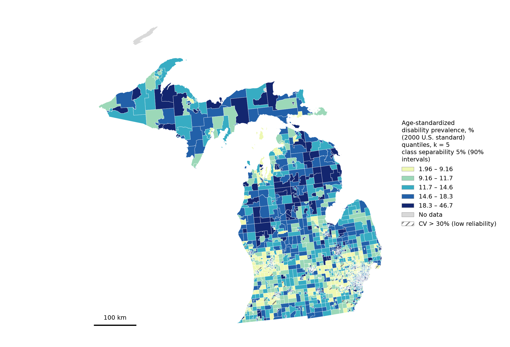
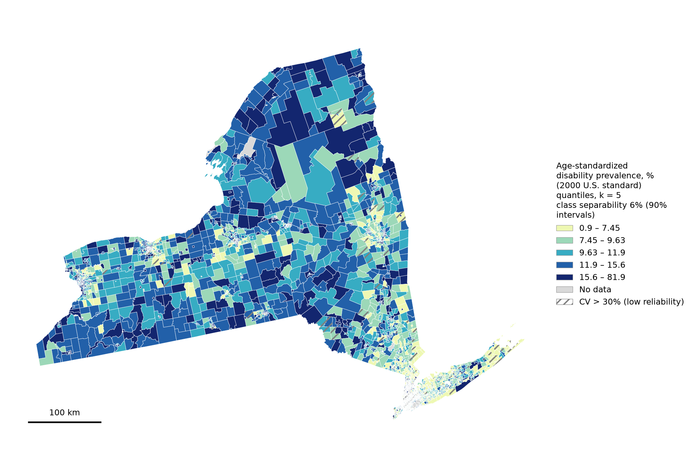
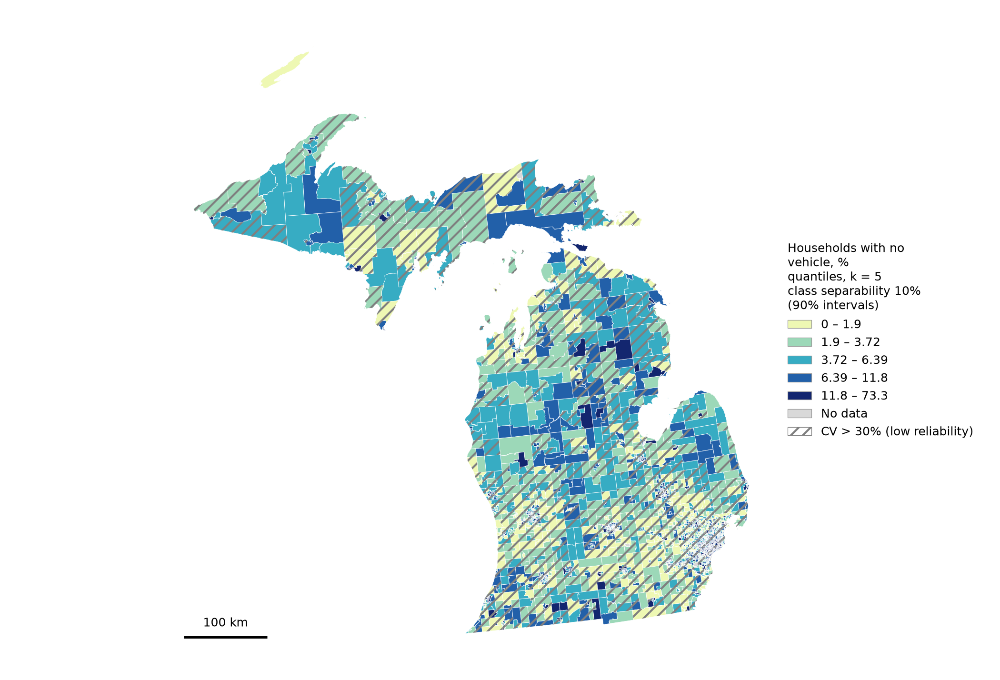
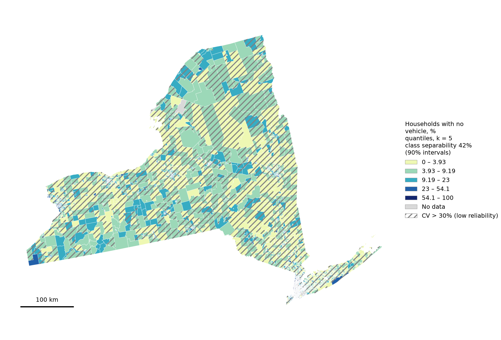
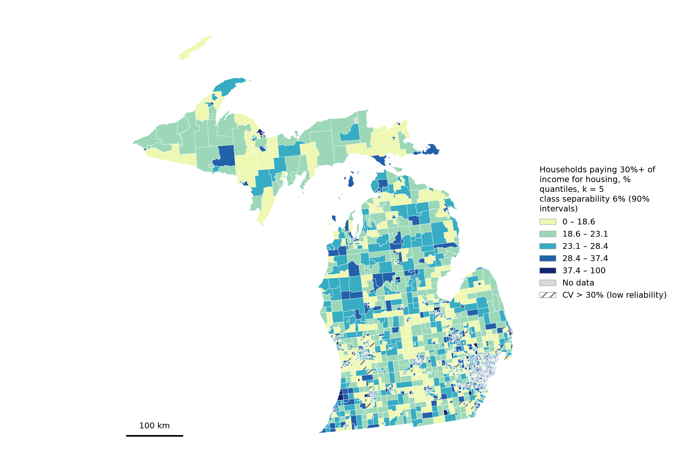
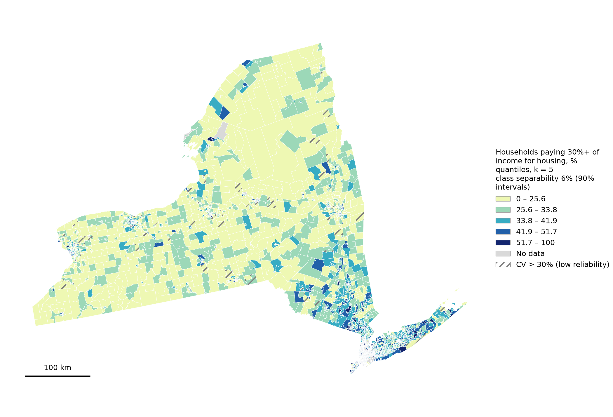

# Disability, vehicle access and housing cost burden across Michigan and New York census tracts, 2020–2024

**Status:** confirmatory run complete; reviewed (section 13: author review delegated by the owner, not independent)
**Study plan:** [PLAN_ROUND_20.md](../../PLAN_ROUND_20.md)
**Manifest:** [`examples/manifests/r20_mi_ny_disability_determinants.json`](../../examples/manifests/r20_mi_ny_disability_determinants.json), SHA-256 `b67232d511556cb2a1af106eabb3d98fcb1f3e175ede63f7c4ccd5b4be72f833`
**Engine:** Census Research Engine, branch `phase20/health-determinants` (released as v0.19.0)

## Summary

The study pre-registered three hypotheses about the 8,059 Michigan and New York census tracts with an age-standardized disability prevalence in the 2020–2024 ACS.

| Hypothesis | Result |
| :--- | :--- |
| **H1** Disability is higher where poverty is higher | **Supported**: +0.32 points per point of poverty (90% CI 0.30 to 0.33) |
| **H2** Beyond poverty, education and cost burden, disability is higher where more households have no vehicle | **Not supported**: +0.007 (90% CI −0.001 to 0.014), Holm p 0.16 |
| **H3** Beyond poverty, education and vehicle access, disability is higher where more households are cost burdened | **Not supported**: the estimate runs the other way, −0.095 (90% CI −0.111 to −0.080) |

The run was confirmatory with no deviations.

What the exploratory analyses add (section 7):
- **H2 is a New York City effect.** Outside New York City, the no-vehicle association is clear: +0.16 points per point (90% CI 0.12 to 0.20). In Michigan alone it is +0.22. Within New York State it is null, because vehicle ownership in the city mostly reflects transit.
- **H3's negative sign comes from New York State.** In Michigan the association is near zero.
- **The registered standard errors are too small.** Model residuals are spatially autocorrelated (Moran's I 0.12 in MI, 0.19 in NY). County-clustered SEs are 2–3 times larger. No conclusion changes.

**Method notes:**
- Disability prevalence is **age-standardized** to the 2000 U.S. standard population. Crude prevalence mostly measures how old a tract's residents are.
- All coefficients are **corrected for ACS sampling error** in the outcome and every determinant, including the correlation between their sampling errors (new estimator `fit_eiv`, section 4). The correction mattered: the naive poverty slope is 0.27, not 0.32, and the cost-burden coefficient is −0.05, not −0.095.

## 1. Question and hypotheses

Across Michigan and New York census tracts in 2020–2024, is age-standardized disability prevalence higher where more households lack a vehicle and more households are housing-cost burdened, beyond what tract poverty and education account for?

| Id | Hypothesis (as registered, abridged) | Model (`fit_eiv`, OLS) | Test |
| :--- | :--- | :--- | :--- |
| H1 | Disability prevalence is higher where the poverty rate is higher (state intercepts) | m1: `asdp ~ pov_rate + C(state)` | `pov_rate` > 0 |
| H2 | ...higher where more occupied housing units have no vehicle, conditional on poverty, bachelor's share, cost burden and state | m2: `asdp ~ pov_rate + pct_bachelors + no_vehicle + cost_burden + C(state)` | `no_vehicle` > 0 |
| H3 | ...higher where more households spend ≥ 30% of income on housing, conditional on the same | m2 | `cost_burden` > 0 |

`C(state)` is `C(GEOID.str[:2])` in the manifest. The correction is Holm across all three hypotheses, at 90%.

This is a **cross-sectional ecological association** study. It makes no causal claim in either direction: disability lowers income, and hardship may worsen health.

## 2. Preregistration and run history

| Event | Time (UTC) | Commit |
| :--- | :--- | :--- |
| Plan committed | 2026-11-15 | `8766501` |
| Engine A1–A3, code review, fixes, simulation validation (passed) | 2026-11-15 | `714fd74`, `87bb2c7`, `64c2680` |
| Cache checked: no tract `B18101`, `B25044`, `B25070` or `B25091` data present | before registration | |
| Manifest committed alone and pushed | 01:58:54 | `bb53959` |
| First study data request (`B18101` tract, Census API) | 01:59:05 | |
| Run 1, the reported confirmatory run (the only run) | 01:59–02:05 | engine at `bb53959` |

**What the authors had seen before registering:**
- county-level income and education for MI/NY (`docs/case_study_mi_ny.md`);
- Round 19's tract income and education (`B19025`, `B19001`, `B15002`, both releases);
- Round 16's tract `B17001` (poverty) replicate files for both releases, used only to measure correlations between neighbouring tracts' sampling errors.

No disability, vehicle or cost-burden data had been downloaded or computed. The relationship of poverty or education with disability had not been looked at.

**Engine changes after the run.** Two engine changes were made after the confirmatory run, both for the exploratory analyses:
- `fit_eiv` now leaves out zero-weight units in weighted fits;
- an optional county-clustered sandwich.

Neither applies to the registered models, which are unweighted and unclustered. The exploratory script re-fits the registered models on the changed engine and reproduces the bundle's estimates exactly (`registered_refit` in `r20/exploratory_summary.json`).

## 3. Data

| Item | Value |
| :--- | :--- |
| Source | ACS 5-year 2020–2024 detailed tables, Census Data API, retrieved 2026-11-15 with the owner's key |
| Tables | `B18101` disability by sex and age (civilian noninstitutionalized population); `B25044` tenure by vehicles available; `B25070` gross rent as % of household income; `B25091` owner costs as % of income, with and without a mortgage; `B17001` poverty; `B15002` educational attainment (25+) |
| Replicates | Census VRE files, 6 tables × 2 states. URLs and SHA-256 in `run.json`; all 12 passed the published-MOE self-check |
| Units | 8,414 tracts. 355 have no standardized rate: 233 have no civilian population, 122 have an empty age band. Models use 8,059 (m1) and 8,057 (m2) tracts |
| Reliability | CV > 30% on `asdp`: 801 tracts flagged and kept (preregistered) |

**Measures:**
- `asdp`: Σ_a w_a × (with a disability)_a / (population)_a × 100.
  - Age bands are 0–17, 18–34, 35–64, 65–74 and 75+, sexes combined.
  - The weights 0.2577, 0.2312, 0.3847, 0.0660 and 0.0603 come from the 2000 U.S. standard population (NCHS, from SEER's single-age table, bundled with SHA-256).
- `pov_rate`: `B17001_002` / `_001` × 100.
- `no_vehicle`: (`B25044_003` + `_010`) / `_001` × 100.
- `cost_burden`: households paying ≥ 30% of income for housing, as a percentage of households with the ratio computed:
  - numerator: renters (`B25070_007`–`_010`), owners with a mortgage (`B25091_008`–`_011`) and owners without one (`_019`–`_022`);
  - denominator: (`B25070_001` + `B25091_001`) − not computed (`B25070_011`, `B25091_012`, `B25091_023`).
- `pct_bachelors`: as Round 19.

Every derived measure got its SE by evaluation on each of the 80 replicates.

| Measure | Mean | SD | Median CV | MI mean | NY mean |
| :--- | ---: | ---: | ---: | ---: | ---: |
| `asdp` (%) | 12.6 | 5.8 | 20% | 14.0 | 11.9 |
| `pov_rate` (%) | 14.4 | 11.9 | 32% | 14.6 | 14.2 |
| `pct_bachelors` (%) | 35.7 | 19.5 | 14% | 30.8 | 38.3 |
| `no_vehicle` (%) | 19.6 | 23.3 | 36% | 7.6 | 26.3 |
| `cost_burden` (%) | 35.0 | 14.3 | 17% | 28.1 | 38.9 |

## 4. Methods

**Age standardization (new this round).** Disability rises steeply with age, so crude prevalence mostly reflects a tract's age structure. Direct standardization asks what each tract's prevalence would be with the standard age structure. The standard is the one used for U.S. age-adjusted health statistics.

**Measurement-error correction (new this round, `fit_eiv`).**
- Every variable here is a tract estimate with sizeable sampling error, with median CVs of 14–36%. In a regression, noise in a determinant flattens its slope.
- When the outcome and a determinant come from the same survey households, their sampling errors are also correlated, which biases the slope further.
- `fit_eiv` estimates both from the ACS replicates, tract by tract, and removes them: Fuller's moment-corrected least squares with known, heteroscedastic error covariance.
- Standard errors are sandwich SEs, treating tracts as independent.
- **Validation** (`docs/audits/eiv_validation.md`, 500 simulations per cell): bias removed in every scenario, and 90% interval coverage of 0.89–0.92. The previous method, regression calibration, ignores the correlated-error term; its coverage fell to 0.04–0.51 when that term was present.

**Measured here:**

| Determinant | Reliability (m2) | Correlation of its sampling error with the outcome's |
| :--- | ---: | ---: |
| `pov_rate` | 0.84 | +0.10 |
| `pct_bachelors` | 0.94 | −0.09 |
| `no_vehicle` | 0.95 | +0.09 |
| `cost_burden` | 0.78 | +0.09 |

Full methods text: `methods.md` in the bundle.

## 5. Confirmatory results

`analysis_status: confirmatory`, deviations: none. Bundle SHA-256 (`bundle.json`): `9d9b1ed9…bc769f162`.

| Hypothesis | Estimate (points of `asdp` per point) | SE (sandwich) | 90% CI | p (one-sided) | p, Holm | Naive estimate | Result |
| :--- | ---: | ---: | :--- | ---: | ---: | ---: | :--- |
| H1 `pov_rate` | +0.316 | 0.0085 | [0.302, 0.330] | 2.3e-300 | 6.8e-300 | +0.275 | **Supported** |
| H2 `no_vehicle` | +0.0066 | 0.0047 | [−0.0011, 0.0143] | 0.078 | 0.156 | +0.0125 | **Not supported** |
| H3 `cost_burden` | −0.095 | 0.0095 | [−0.111, −0.080] | 1.0 | 1.0 | −0.051 | **Not supported** (opposite sign) |

Other m2 coefficients:
- `pov_rate` +0.303;
- `pct_bachelors` −0.087;
- New York intercept −0.46 relative to Michigan.

## 6. Reading the results

- **H1.** A tract with 10 points more poverty has about 3.2 points higher age-standardized disability prevalence. This is large, precise and robust in every variant (section 7). It is the well-documented disability–poverty gradient, now measured with the age confound and the sampling-error bias both removed.
- **H2.** The pooled estimate is near zero, but section 7 shows this is not "no association". The association is clear and sizable outside New York City, and absent within it. Vehicle-free households in the city reflect transit and density more than hardship. In the pooled model, the city's 2,194 tracts, with very high no-vehicle shares and moderate disability, dominate the slope. The registered hypothesis did not anticipate this. The finding is **exploratory**.
- **H3.** Holding poverty, education and vehicle access fixed, tracts with more cost-burdened households have *lower* disability prevalence. The association is concentrated in New York State, and near zero in Michigan. One plausible reading is that, once poverty is held fixed, high cost burden marks expensive housing markets (New York City and its suburbs), where disability prevalence is lower for reasons this model does not capture. That reading is **untested** and stated only as a hypothesis for later work. The finding does not show that cost burden protects against disability.

## 7. Exploratory analyses (pre-specified unless marked)

All are refits on the analysed data (hashes checked), labelled exploratory with the manifest hash (`r20/exploratory_summary.json`).

| Variant | H1 `pov_rate` | H2 `no_vehicle` | H3 `cost_burden` | Tracts (m2) |
| :--- | :--- | :--- | :--- | ---: |
| Registered (`fit_eiv`) | 0.316 [0.302, 0.330] | 0.007 [−0.001, 0.014] | −0.095 [−0.111, −0.080] | 8,057 |
| E1 naive `fit_replicate` (conservative) | 0.275 [0.249, 0.301] | 0.013 [0.005, 0.020] | −0.051 [−0.070, −0.031] | 8,057 |
| E1 regression calibration | 0.370 [0.356, 0.385] | 0.007 [0.001, 0.014] | −0.098 [−0.112, −0.085] | 8,057 |
| E2 without New York City | 0.328 [0.311, 0.346] | **0.160 [0.125, 0.195]** | −0.052 [−0.074, −0.030] | 5,863 |
| E2 Michigan only | 0.323 [0.299, 0.346] | **0.221 [0.151, 0.291]** | −0.007 [−0.050, 0.037] | 2,868 |
| E2 New York only | 0.312 [0.294, 0.329] | 0.005 [−0.005, 0.015] | −0.118 [−0.135, −0.100] | 5,189 |
| E3 crude (not age-standardized) prevalence | 0.250 [0.226, 0.274] | 0.020 [0.012, 0.029] | −0.130 [−0.153, −0.108] | 8,148 |
| E4 CV-flagged tracts dropped | 0.343 [0.330, 0.356] | −0.001 [−0.009, 0.008] | −0.073 [−0.089, −0.056] | 7,256 |
| E4 household-weighted | 0.328 [0.315, 0.342] | 0.005 [−0.001, 0.012] | −0.087 [−0.100, −0.073] | 8,057 |
| E5b county-clustered SEs (added after E5) | 0.316 [0.284, 0.348] | 0.007 [−0.008, 0.021] | −0.095 [−0.140, −0.050] | 8,057 |

**What the variants show:**
- **E1: the correction matters, in both directions.** The naive fit understates the poverty slope (attenuation). It overstates the vehicle association and understates the cost-burden association.
  - Regression calibration *overshoots* the poverty slope (0.370), because it ignores the positive correlation between poverty's and disability's sampling errors. The simulation predicted exactly this.
  - `fit_eiv` sits between the two.
- **E2: H2 is a transit artefact.** See section 6.
- **E3: standardization matters.** On crude prevalence, the poverty slope is 21% smaller and the vehicle association appears, because older tracts have fewer vehicles and more disability. Age standardization removes that confound.
- **E5: residuals are spatially autocorrelated.** Moran's I of the m2 residuals (queen contiguity) is 0.12 in Michigan and 0.19 in New York, permutation p 0.001 for both. The registered sandwich treats tracts as independent, so its SEs are too small.
  - E5b, added after seeing E5 and therefore not pre-specified, clusters by county. SEs grow 2.3× (H1), 1.9× (H2) and 2.9× (H3).
  - H1 remains far from zero, H2 remains unsupported, and H3's interval still excludes zero. No conclusion changes, but **the registered intervals are too narrow and should be read with E5b next to them.**
- **E6: maps.** These are the levels of the three measures, with CV > 30% hatched. New York City tracts are unreadable at state scale (friction F9).








## 8. Limitations

- **Ecological and cross-sectional.** These are tract-level associations, not statements about disabled people or households, and not causal effects in either direction.
- **The disability measure.** It is ACS self-report on six functional questions, covering the civilian noninstitutionalized population. Nursing-home residents are excluded, which removes much of the oldest, most disabled population unevenly across tracts. For children under 5, only hearing and vision are asked.
- **Spatial dependence.** The registered SEs assume independent tracts, and the residuals are clearly not independent (E5). County-clustered SEs are 2–3 times larger. Future manifests should register clustered SEs (friction F6).
- **Measurement-error model.** `fit_eiv` assumes additive sampling errors, uncorrelated with the true values, whose covariance the replicates estimate. It does not correct for non-sampling error (e.g. response error in the disability questions). For ratios of estimates, such as the shares here, the additive form holds only approximately.
- **Collinearity.** Poverty, education, vehicle access and cost burden are correlated. The H2 and H3 coefficients are conditional associations whose meaning depends on the other terms in the model.
- **Composite measures.** `cost_burden` pools renters and owners, who face different markets. `no_vehicle` is a household share, not a person-level measure of mobility.
- **Empty age bands.** 122 populated tracts have no standardized rate because one age band is empty. They are dropped (complete case), with no preregistered fallback (friction F7).
- **Period.** 2020–2024 includes the pandemic and the 2020 collection disruptions.

## 9. Reproduce

```sh
python -m census tool create_manifest --arg manifest_path=examples/manifests/r20_mi_ny_disability_determinants.json --json
python -m census tool run_manifest --arg manifest_path=examples/manifests/r20_mi_ny_disability_determinants.json \
    --arg output_dir=studies_output/r20/confirmatory --json
python scripts/r20_exploratory.py studies_output/r20/confirmatory studies_output/r20/exploratory
python scripts/eiv_validation.py --sims 500      # the fit_eiv validation table
```

The run outputs (bundle, `analysed/`, exploratory outputs) are attached to the v0.19.0 GitHub release.

## 10. Friction log

| # | Friction | Status |
| :--- | :--- | :--- |
| F1 | No age standardization: crude disability prevalence mostly measures age structure | **Fixed** (A1: `census.standardize`, `age_standardized` derivation, bundled 2000 U.S. standard) |
| F2 | Regressions on ACS-estimated determinants were biased by attenuation and correlated outcome–covariate errors; regression calibration handles only the first | **Fixed** (A2: `fit_eiv`, validated; A3: reliability notes in `fit_replicate`) |
| F3 | The bundled standard-population CSV was git-ignored (global `*.csv`), so a fresh clone would fail | **Fixed** in code review, before registration |
| F4 | The reliability note grouped `C(GEOID.str[:2])` by tract, not state | **Fixed** in code review |
| F5 | `fit_eiv` refused zero weights (tracts with people but no households, e.g. dormitories) | **Fixed** after the run (exploratory WLS only) |
| F6 | The independence sandwich understates SEs when residuals are spatially autocorrelated (2–3× here) | **Partly fixed**: `fit_eiv(cluster=...)` added (exploratory use). Backlog: validate clustered SEs by simulation and recommend `cluster` in health manifests |
| F7 | Tracts with one empty age band get no standardized rate (122 here) | Backlog: a preregistrable fallback (collapse adjacent bands, or flag) |
| F8 | Exploratory variants (subsets, crude rate, weights, clustering) need Python, as in Round 19 F9 | Backlog: `run_manifest_variant` |
| F9 | New York City tracts unreadable at state scale (Round 19 F8) | Backlog: `make_map` insets |
| F10 | A 55-variable frame triggers pandas fragmentation warnings in `analysis_frame` | Backlog (performance only) |

## 11. Review

**Who reviewed.** The owner delegated this review to the study's author (`agent:claude`). It is an **author self-review against evidence, not an independent review**. 2026-11-15.

- [x] **The preregistration commit precedes all study data requests.** The manifest commit `bb53959` is at 01:58:54Z. The first API response for `B18101`, `B25044`, `B25070` or `B25091` is at 01:59:05Z, and the first VRE file at 01:59:32Z. The cache held none of them before (checked twice). Poverty and education data for these tracts had been seen in earlier rounds, as disclosed in section 2.
- [x] **The hypotheses, as tested, match the registered manifest.** The manifest is unchanged since `bb53959`. `bundle.json` and every result carry hash `b67232d5…f833` and `analysis_status: confirmatory`.
- [x] **One run, no reruns.** Engine changes after the run do not touch the registered models; the re-fit reproduces them exactly.
- [x] **Interpretation.** H2 is reported as not supported, with the NYC split as exploratory. H3 is reported as not supported (opposite sign), with its explanation labelled untested.
- [x] **Limitations.** They are adequate, and the SE understatement found in E5 is stated prominently in the summary, section 7 and section 8.
- [x] **Reviewer comments:**
  1. H1 is solid. H2 and H3 are honest null and opposite-sign results, and the exploratory analysis explains most of both.
  2. The most important methodological lesson is E5. Tract-level health models need spatially robust SEs by default. The next health manifest should register `cluster: county`, after the clustered sandwich is validated by simulation (F6).
  3. The H2 result suggests a follow-up preregistered study that tests the vehicle association outside dense transit areas, with the urban/transit definition fixed in advance.
  4. As in Round 19, an independent review is advisable before these results are cited outside the project.
