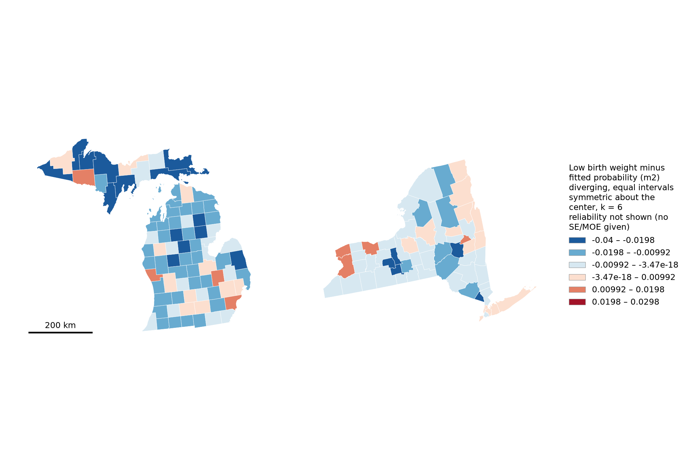

# Low birth weight and the Round 20 determinants: Michigan and New York counties

**Status:** registered confirmatory run complete; exploratory checks complete; author self-review, not independent.
**Study plan:** [PLAN_ROUND_22.md](../../PLAN_ROUND_22.md), section 5.
**Manifest:** [r22_mi_ny_county_low_birth_weight.json](../../examples/manifests/r22_mi_ny_county_low_birth_weight.json), canonical SHA-256 `10c46acedc6eff827d8a41df34d272f839ed0d75804666e81b77ca75eab83ea6`.
**Engine:** Census Research Engine 0.21.0, branch `phase22/count-outcomes`; no tag or release created.

## Summary

County low birth weight is positively associated with poverty in the registered state-intercept model,
and positively associated with housing cost burden in the registered adjusted model. These are H1
and H2, both supported after Holm correction. The positive vehicle-access hypothesis H3 is not
supported. The two quasi-binomial models use 144 counties and live births as trials; Pearson dispersion
is 21.99 and 21.02, so ordinary binomial model SEs would substantially understate overdispersion.

These results depend on the declared specification. Without NYC, the adjusted vehicle coefficient
becomes positive. With race/ethnicity composition added, the housing-cost coefficient becomes negative.
Those are planned **exploratory** results, not replacements for the registered tests. Residual Moran's I
is 0.184 (999 permutations, p_sim=0.003), and the prescribed spatial-HAC coverage validation failed.
Consequently the registered SEs assume spatial independence; support under that assumption is not
robust evidence of a causal or specification-independent relationship.

## 1. Question and hypotheses

Does the CHR&R 2025 low-birth-weight proportion vary with the ACS determinants studied in Round 20,
among Michigan and New York counties? This is a county association study, not an individual risk model.

| Analysis | Formula | Registered test |
| :--- | :--- | :--- |
| m1 | `lbw ~ pov_rate + C(GEOID.str[:2])` | H1: poverty coefficient >0 |
| m2 | `lbw ~ pov_rate + pct_bachelors + no_vehicle + cost_burden + C(GEOID.str[:2])` | H2: cost-burden coefficient >0; H3: no-vehicle coefficient >0 |

All four determinants are percentages: one coefficient unit is **one percentage point**. The models are
quasi-binomial with logit link, `lbw_denominator` trials, `scale: "X2"`, population interval target.
Holm adjusts the three directional tests as one family at alpha 0.10. The individual 90% intervals are
not simultaneous, multiplicity-adjusted intervals. The manifest contains the complete hypothesis text.

## 2. Data

- **Outcome:** CHR&R 2025 analytic file, measure `v037`, proportion of live births under 2,500 g.
  Source: NCHS Natality files (NVSS), **2017–2023**. The denominator is live births with recorded birth
  weight. [The CHR measure page](https://www.countyhealthrankings.org/health-data/population-health-and-well-being/quality-of-life/physical-health/low-birth-weight)
  explicitly identifies these years for the 2025 release; its newer 2026 release is not used.
  The [2025 data dictionary](https://www.countyhealthrankings.org/sites/default/files/media/document/DataDictionary_2025.pdf)
  identifies the numerator, denominator and unreliability flag.
- **Cached file:** `analytic_data2025_v2.csv`, 13,085,361 bytes, SHA-256
  `fe94ca504dd8688d55429b908540241bc420466ebc5556cbe27e84adf7aefbcf`.
  Its cached acquisition date is 2026-11-15T16:42:29Z, **before this study's registration**; prior outcome-only
  coverage inspection is disclosed below. CHR&R's non-commercial research terms apply. The raw file is
  not redistributed in this report.
- **Coverage:** 145 ACS counties (83 Michigan, 62 New York); 144 have a usable outcome. GEOID `26083`
  has no external outcome, 1/145=0.69%, below the existing 5% join-missing limit. The joined run frame
  retains 145 rows; each model uses 144 complete cases. Two counties have fewer than 20 low-weight
  births: they are retained, weighted by their births. Missing/suppressed outcomes are never zero-filled.
- **Determinants:** ACS 2018–2022 5-year county estimates, release 2022. B17001 poverty, B15002
  education, B25044 vehicle access, B25070 renter costs and B25091 owner costs. Derivations and the
  CV screen are copied from Round 21 Part 2, removing `asdp` and all B18101 inputs. The screen's
  registered action is `flag`, not exclusion; it does not remove either small-count county.
- **Uncertainty:** Census VRE refits propagate ACS covariate sampling uncertainty into `se_sampling`.
  The registered population tests use Pearson-scaled `se_model`. The LBW proportion and its live-birth
  trials stay fixed across those refits; no GLM measurement-error correction is claimed.

## 3. Preregistration

The engine and validation decisions were committed as `85a8caf`, with the final pre-study methods
clarification `31e55ed`. The manifest was then committed **alone** as
`7b967d1ebfeaa369b9dabeb7f81cecdf4d1ec037` (2026-11-15T15:50:25-05:00), including its canonical
SHA-256 in the commit message, and pushed to `phase22/count-outcomes` **before** the first
`run_manifest` call. No LBW–determinant association was computed, plotted or inspected beforehand in this implementation.
The main manifest was not changed after fitting. The policy decision from the failed A2 validation
was applied before registration: neither m1 nor m2 contains `spatial_se`.

Planner disclosure, copied from the supplied plan:

> While writing this plan, the planner looked only at the outcome's coverage in the cached file: 145 Michigan and New York counties; low birth weight (`v037`) numerator missing for 1 county; median numerator 297 low-weight births; median denominator 3,917 births. No association with any determinant was computed.

X1 and X2 were specified in the plan and saved with `exploratory: true`; their manifest commit is
`e8e8d20`. They are exploratory even though their specifications were written before their execution.
Their hashes are in section 6 and the sanitized summary.

## 4. Engine work

- **A1:** boolean `exploratory` flag; status/provenance/hypothesis labels remain exploratory even
  when blocking deviations are recorded. Ordinary manifests retain the existing status rules.
- **A2:** Bartlett Conley covariance from per-unit EIV moments or binomial/Poisson GLM scores,
  great-circle representative-point distances, n/(n-k) correction, explicit non-PSD diagnostics,
  boundary-file hashes and source-aligned coordinates. Exact independence and cluster identities pass.
  The fixed six-cell simulation **FAILED**: 150-km coverage was linear 0.8735/0.8170/0.7070 and
  binomial 0.8345/0.7835/0.7285, at ranges 0/50/100 km. All six were required to be >=0.86.
  See [spatial HAC validation](../audits/spatial_hac_validation.md). The functions are exploratory only;
  confirmatory manifests reject them. No criteria, seeds or design were changed.
- **A3:** explicit binomial denominator trials and Poisson count/exposure roles, Pearson dispersion
  scaling, preserved replicate sampling SEs and circularity checks, CHR `v037` source text, odds-ratio
  output for binomial hypotheses. External WLS/negative-binomial and effective-trials fallback are refused.
- **A4:** held-out OH/PA split-tract test **PASSED**, ratio 0.912797 <=1.25, 499 high-share targets.
  [Re-test audit](../audits/rate_apportionment_retest.md), pre-run commit `d8ad360`.
  Opt-in `dominant` inherits only when parent population share >=0.95; the default stays `missing`.
  This county study does not use tract apportionment.
- No new dependencies or MCP tools: the full tool count remains **63**. Version metadata is 0.21.0;
  no GitHub CI, merge, tag, release or WONDER automation was performed.

## 5. Results

The run completed with `analysis_status: confirmatory`, no blocking deviations, and 144 observations
per model. Pearson dispersion was 21.9926 (m1) and 21.0188 (m2). All registered coefficients below are
on the **logit scale per percentage point**, with odds ratios computed separately for **10 percentage
points** as exp(10 × estimate). The bundle's own odds-ratio columns are per one percentage point.

| Hypothesis | Model | Term | Estimate | Individual 90% CI | OR per 10 pp (90% CI) | Holm p, directional | Result |
| :--- | :--- | :--- | ---: | :--- | :--- | ---: | :--- |
| H1 | m1 | pov_rate | 0.014654 | 0.011236 to 0.018072 | 1.1578 (1.1189–1.1981) | 2.65109e-12 | Supported |
| H2 | m2 | cost_burden | 0.006124 | 0.002537 to 0.009710 | 1.0631 (1.0257–1.1020) | 0.00498352 | Supported |
| H3 | m2 | no_vehicle | -0.001432 | -0.003081 to 0.000216 | 0.9858 (0.9697–1.0022) | 0.923584 | Not supported |

m2 poverty is +0.011994 (90% CI 0.006160 to 0.017828); the bachelor's-share coefficient is
−0.001110 (−0.003357 to 0.001138). Neither is an additional registered hypothesis in m2.
Positive coefficients do not establish that changing a county determinant changes birth outcomes.

## 6. Exploratory

All X1–X5 outputs are labelled exploratory, with their related manifest hashes.
Summary: [exploratory_summary.json](r22/exploratory_summary.json), SHA-256
`818543c462d2f3f1f1ce01f91335fde315b764e15e79359dcf23aff016a6bab3`. It records analysed-input hashes, models, hypothesis rows, spatial diagnostics and figure hashes.

### X1: without New York City

Manifest hash `0d5e657b1bd86658ed950fd32eda96832614ae0e2ad1932cf1eddd6daeeaeba9`.
The five registered NYC GEOIDs are excluded; 139 complete counties remain. m2 no-vehicle becomes
**+0.033433** (90% CI 0.022658 to 0.044208), versus −0.001432 in the full study. Cost burden stays
positive: +0.006550 (0.002304 to 0.010797). Poverty in m1 is +0.018368; in the adjusted m2 it is
−0.002971 (−0.011481 to 0.005539). The vehicle association is sensitive to the transit-dense NYC counties.

### X2: race/ethnicity composition

Manifest hash `9e83d6a0f361496ded30a95c8373f61fa924875ca62bd2252242312c8e8f6a79`.
B03002 adds the non-Hispanic Black population share to m2, with its own Census replicates; n=144.
The coefficient is +0.012201 (0.009674 to 0.014728). Cost burden changes sign to **−0.003827**
(−0.007491 to −0.000164), and no-vehicle is +0.000346 (−0.001110 to 0.001803).
Poverty is −0.002453 (−0.008263 to 0.003357). These are conditional county-composition associations;
race/ethnicity is not interpreted as a biological cause. Structural and contextual confounding remain.
This planned exploratory control does not amend the registered m2 or its H2 result.

### X3: spatial-SE sensitivity — not validated

Conley SEs were refitted at 50, 100 and 200 km, retaining Pearson X2 fitting and the same observations
and point estimates. The sandwich itself does not multiply by the dispersion scale.

| Cutoff km | m1 poverty SE | m2 cost-burden SE | m2 no-vehicle SE |
| ---: | ---: | ---: | ---: |
| 50 | 0.004637 | 0.003846 | 0.002534 |
| 100 | 0.004818 | 0.003799 | 0.002669 |
| 200 | 0.005132 | 0.003448 | 0.002731 |

Compare the registered independence SEs 0.002078, 0.002181 and 0.001002 respectively. These
exploratory spatial estimates are larger here, but cannot be promoted as validated replacements:
the pre-set spatial coverage criterion failed. No confirmatory hypothesis was reclassified using them.

### X4: residual geography



Observed LBW proportion minus fitted probability (m2); 0.01 corresponds to one percentage point.
The map is descriptive, without residual SE/MOE shading. It uses 2022 county boundaries and excludes
the one county without an outcome. Queen contiguity, row standardized: **Moran's I=0.183552**,
expected under randomization −1/143, permutation **p_sim=0.003**, 999 permutations, seed **20261122**.
This diagnostic is evidence against spatial randomness of these residuals, not a causal model or an
SE correction. Disconnected components/islands and weights provenance are preserved in the summary.

### X5: Poisson cross-check

Quasi-Poisson m2 uses `lbw_numerator` counts and `lbw_denominator` exposure, Pearson X2, n=144.
Poverty is +0.010924 (90% CI 0.005599 to 0.016249), cost burden +0.005586 (0.002304 to 0.008868),
and no-vehicle −0.001301 (−0.002807 to 0.000205). These log-rate coefficients are close to the
registered logit coefficients (+0.011994, +0.006124, −0.001432), as expected for a relatively rare
outcome. Their coefficients are log rate ratios, not odds ratios. This is an exploratory cross-check.

## 7. Interpretation

Under the registered specification, poverty in the state-intercept model and housing costs in the
adjusted model track higher LBW proportions. The data do not support the registered positive
vehicle-access hypothesis. That result is not repaired or replaced by the without-NYC sensitivity.

The exploratory controls show that the coefficient pattern depends strongly on geographic leverage
and composition. These county determinants are correlated proxies for social and material conditions.
Neither the housing coefficient nor the race/ethnicity-composition coefficient identifies an individual
mechanism. A county with a higher percentage can differ in many other respects from another county.

## 8. Limitations

- **Ecological inference:** county associations do not identify maternal/infant risk or causal effects.
- **Timing:** natality 2017–2023 overlaps ACS 2018–2022 but does not match it exactly; these are pooled,
  cross-sectional county summaries, not longitudinal or difference-in-differences estimates.
- **Covariate measurement error:** there is no EIV/corrected-score correction for these GLMs. Replicate
  `se_sampling` propagates ACS uncertainty only. Registered tests target the population model SE.
- **Spatial dependence:** the main SEs assume spatial independence. Residual Moran's I is positive;
  the prescribed Conley validation failed. Pearson scaling handles overdispersion, not arbitrary
  cross-county dependence. Reported p-values/support remain conditional on the independence assumption.
- **Missing/suppressed county:** one missing CHR outcome is excluded by complete-case fitting, not
  treated as zero. Small unreliably flagged counts are retained; birth weights missing from natality
  denominators and source suppression can still affect representativeness.
- **Specification sensitivity:** NYC leverage and the exploratory race/composition control alter
  important conditional associations. No race control was added to the confirmatory models after fitting.
- **Weights and precision:** births-weighted quasi-binomial fitting emphasizes counties with more births.
  The raw published proportion has finite precision; the count-based Poisson check uses actual numerators.
- **Reproducibility:** cache/input hashes fix this run; future Census/CHR revisions or software versions
  may change numerical or figure bytes. Full local raw study outputs are git-ignored; the cached CHR file
  is not redistributed. This report and summary preserve the results and input identities.

## 9. Reproduction

Use the project `.venv` (Python 3.11+, SciPy 1.16+) and the existing authorized CHR cache.
Keep the Census key in ignored `.env`; the commands do not print it. Start with a **fresh** output root:

```bash
export OPENBLAS_NUM_THREADS=1
export MPLCONFIGDIR=/tmp/r22-mpl
export R22_OUT=$(mktemp -d /tmp/r22-reproduce-XXXXXX)
.venv/bin/python -m census tool run_manifest "{\"manifest_path\":\"examples/manifests/r22_mi_ny_county_low_birth_weight.json\",\"output_dir\":\"$R22_OUT/confirmatory\"}" --json
.venv/bin/python -m census tool run_manifest "{\"manifest_path\":\"examples/manifests/r22_x1_without_nyc.json\",\"output_dir\":\"$R22_OUT/x1_without_nyc\"}" --json
.venv/bin/python -m census tool run_manifest "{\"manifest_path\":\"examples/manifests/r22_x2_race_composition.json\",\"output_dir\":\"$R22_OUT/x2_race_composition\"}" --json
.venv/bin/python scripts/r22_exploratory.py "$R22_OUT"
```

The original run used `studies_output/r22` as the output root. The script checks the saved analysed
input hashes before refitting and uses the saved full-sample coefficients to reconstruct residuals.
Running the script copies newly generated exploratory figures/summary into `docs/studies/r22`.
Compare substantive coefficients and hashes against the versioned summary; figure metadata may vary.

Validation and tests (local only; no GitHub CI):

```bash
OPENBLAS_NUM_THREADS=1 .venv/bin/python scripts/spatial_hac_validation.py
.venv/bin/python scripts/rate_apportionment_validation.py --states 39 42 --parent-share-min 0.95 --out docs/audits/rate_apportionment_retest.md
.venv/bin/python -m pytest -q -p no:cacheprovider
```

The original A4 design/script were committed before the first held-out run. Re-executing a validation
records the current execution checkout and must not alter its fixed criterion or seeds.

## 10. Friction log

| ID | Observation / workaround | Status |
| :--- | :--- | :--- |
| F1 | Spatial HAC failed the fixed 90% coverage criterion despite passing exact identities. The study therefore retains independence SEs; spatial sensitivities are explicitly not validated. | Backlog: a separately pre-registered spatial-inference method; no threshold/design tuning here |
| F2 | The Moran workflow does not expose a permutation seed. The script calls existing `spatial.morans_i` directly with seed 20261122 and 999 permutations. | Backlog; no new tool or argument added outside this round's listed scope |
| F3 | Response residuals are not an exposed fitted-model artifact. The script reconstructs them from the saved coefficients and patsy design, after verifying analysed-input hashes. | Backlog; reproduction is explicit in `scripts/r22_exploratory.py` |
| F4 | The diverging map legend displays a floating-point value very close to zero rather than a rounded zero. | Backlog: display-only formatting; no map redesign/formatting sweep |
| F5 | Exploratory status, explicit count roles and count-model dispersion were missing from the prior engine path. | Fixed in A1/A3, with offline regressions |

## 11. Review (author self-review at the owner's request, not independent)

- **Registration order:** validations and engine commits precede `7b967d1`; that exact manifest hash was
  pushed before either LBW model ran. The planner's outcome-only coverage inspection and the pre-existing
  CHR cache are disclosed; no claim of unseen raw outcomes is made.
- **Estimator checks:** score/bread weights, great-circle identities, cluster/independence limits,
  n/(n-k), complete-case coordinate alignment and unchanged scale-None behavior were reviewed/tested.
  Numerical/role fixes were completed before the main registration, without weakening tests. A later
  invalid-input check standardized ValueError for nonnumeric spatial cutoffs; registered numeric
  cutoffs, study fits, simulation results and the committed main manifest were unchanged.
- **Status checks:** both X1/X2 run and per-analysis provenance are exploratory; blocking deviations
  would remain recorded. Main results retain their original confirmatory status and three hypotheses.
- **Local verification:** full suite **1,628 passed, 37 skipped, 0 failed, 48 subtests passed**;
  final targeted cutoff-error checks **15 passed**. All 11 example manifests validate; MCP count is 63.
- **Numbers:** the results table is generated from `bundle/results/hypotheses.json`; OR per 10 pp
  explicitly exponentiates ten times the stored logit estimate. Exploratory numbers are drawn from the
  hashed summary, not substituted into the registered table.
- **Circularity:** v037 is a direct natality outcome the ACS lacks. R1/R2 remain enforced, including
  tests that CHR v060 diabetes cannot be tested against poverty. No model-derived outcome is substituted.
- **Evidence/limits:** the map was inspected for legibility; it is descriptive. Residual spatial
  dependence, failed Conley coverage, no GLM EIV correction, suppressed county and sensitivity to controls
  are all explicit. A separate independent review is still needed before external citation.
- **Secrets and scope:** new generated outputs are scanned for the literal configured Census key,
  printing only the hit count. No tags/releases/merges/CI runs, no new source connector or dependency,
  no WONDER automation, and no new MCP tool.
